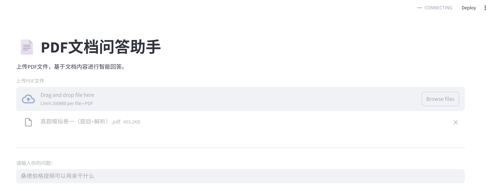
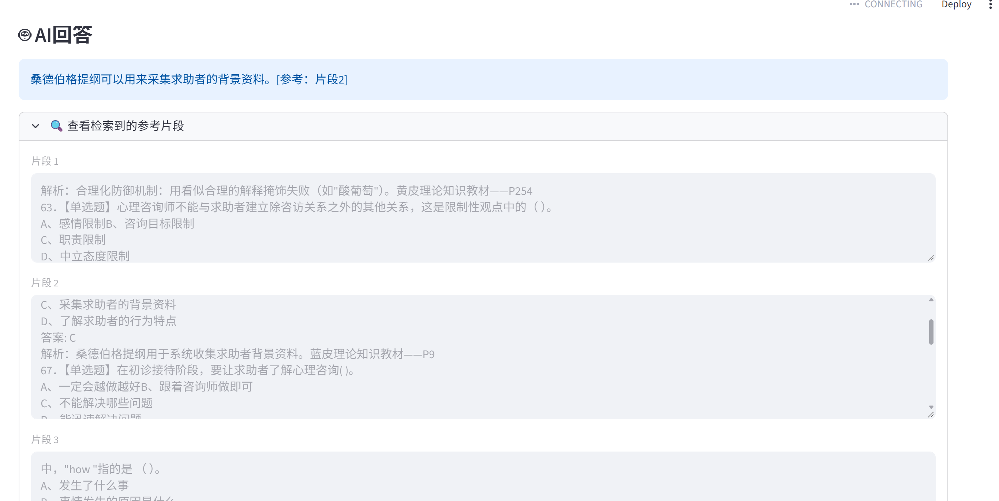

# 🤖 大模型应用开发学习与实践 (LLM Application Learning)

这个仓库记录了我从零开始学习大模型应用开发的过程，包含我独立完成的三个实战项目。

## 📂 项目目录

- `src/week3_chatbot.py`: 命令行 AI 聊天机器人（支持多轮对话与流式输出）
- `src/week4_pdf_rag.py`: 命令行版 PDF 文档问答助手（RAG）
- `src/week5_rag_app.py`: **带 Web 界面的 PDF 文档问答助手（Streamlit）**

## 🚀 核心项目展示：PDF文档问答助手（RAG Web版）

这是一个基于 RAG（检索增强生成）架构的 Web 应用。用户可以上传 PDF 文档，并用自然语言提问，系统会基于文档内容精准回答，并标注引用来源。

### ✨ 功能亮点
- **Web UI 界面**：使用 Streamlit 搭建，支持拖拽上传 PDF。
- **混合检索策略**：向量检索（阿里云 Embedding） + 关键词检索（BM25），大幅提高检索召回率。
- **引用溯源**：大模型回答时标明参考的文档片段。
- **状态缓存**：使用 `session_state` 缓存处理结果，避免重复消耗 API 费用。

### 📸 效果截图
*(这里粘贴你刚才上传图片生成的 Markdown 代码)*


### 🛠️ 如何本地运行
```bash
# 1. 安装依赖
pip install -r requirements.txt

# 2. 运行 RAG Web 应用
streamlit run src/week5_rag_app.py

## 项目 4：全能实时 AI 助手 (Agent + Web UI)

### 核心功能
- **自主决策**：基于 LangChain 1.x `create_agent` 构建，能自主判断是否需要调用工具。
- **多轮记忆**：利用 Streamlit `session_state` 实现网页端的连续对话。
- **工具集成**：接入 DuckDuckGo 联网搜索与时间获取工具。
- **防幻觉控制**：通过强约束的 System Prompt，确保搜索失败时如实告知用户，拒绝编造。

## 项目 5：企业级渐进式路由 Agent (Full-Stack Agent)

架构核心：基于 Harness 架构设计了渐进式披露路由（Progressive Disclosure），将 Prompt 的 Token 成本降低了 80%。

多技能协同：实现了 RAG（私有文档向量检索）、Graph（基于 NetworkX 的多跳关系推理）与 Web Search（联网实时检索）的混合路由。

工程优化：在联网搜索前引入 LLM Query 改写机制，大幅提升了搜索引擎的召回精度。

## 项目名称 6：企业级渐进式路由多智能体 Agent（全栈独立开发）

微服务架构：基于 FastAPI 构建后端服务，Streamlit 作为前端展示，实现前后端彻底解耦；通过 CORS 处理跨域，使用 Pydantic 进行数据校验。

渐进式路由（Harness）：设计轻量级 Router 调度器，根据用户意图动态挂载四大技能（企业 RAG、NetworkX 图谱查询、实时联网、文案生成），大幅降低主模型 Token 消耗与幻觉。

多智体协同（Multi-Agent）：引入 LangGraph 构建 Writer 与 Reviewer 的状态图（StateGraph）。利用条件边（Conditional Edges）实现“撰写-审核-打回重写”的自反思闭环，并加入熔断机制防止无限死循环。

工程化优化：使用 lru_cache 实现高频请求的内存缓存，针对重复问题响应时间从数秒降至毫秒级，彻底阻断 API 重复计费；加入了基于 Node 存在性校验的防御性编程，彻底解决实体查询崩溃问题。

### 运行方式
```bash
streamlit run app.py
